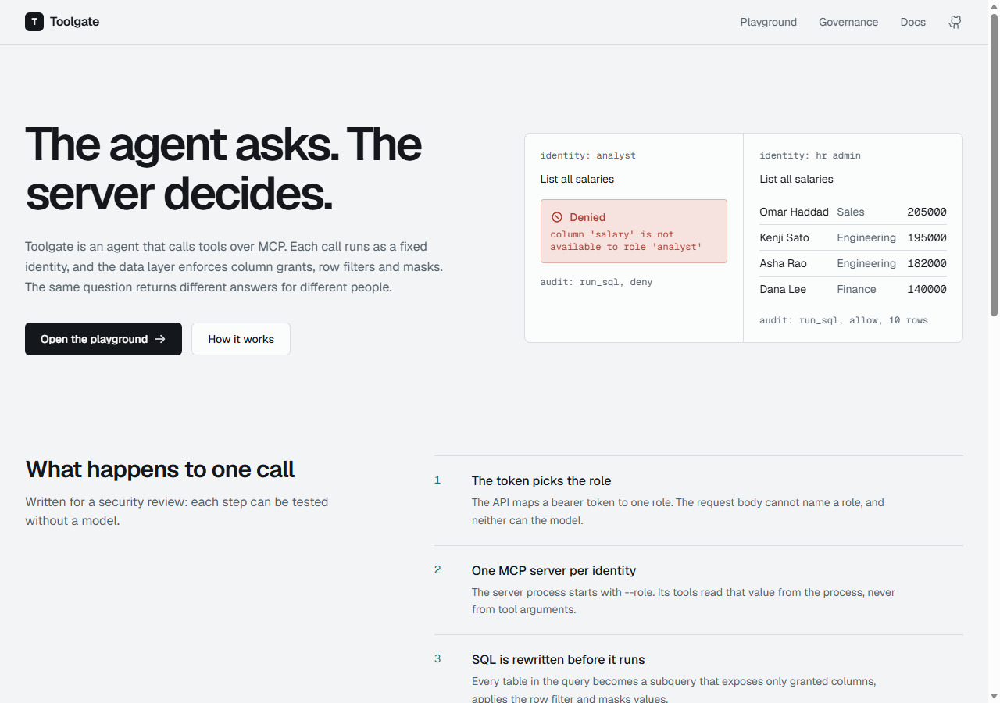

# Toolgate


An AI agent that calls tools over the Model Context Protocol (MCP), where the **server decides what data the agent can see**. Each call runs as a fixed identity. Column grants, row filters and masks are enforced in the data layer, so a prompt cannot talk its way past them.



The same question, two identities:

| Question: "List all salaries" | Result |
|---|---|
| analyst | Denied: `column 'salary' is not available to role 'analyst'` |
| hr_admin | Ten rows with salary, personal email masked |

## Inspiration and scope

The idea comes from an enterprise pattern built on Databricks (Agent Framework, Unity Catalog, Vector Search, Genie, LangGraph). **This project does not use Databricks.** It rebuilds each idea locally and for free:

| Pattern | What is built here |
|---|---|
| Unity Catalog grants | `policy.json`: per-role column grants, row filters, masks. Enforced by rewriting SQL |
| Vector Search | SQLite + numpy cosine search. Per-document role ACL is applied before ranking |
| Genie (natural language to SQL) | The model writes SQL. A sqlglot-based guard validates and scopes it |
| Agent Framework | LangGraph graph with a real MCP client and server |
| Model | Ollama `qwen2.5:3b`, free and local. Any OpenAI-compatible endpoint also works |

## Architecture

```
browser --Bearer token--> FastAPI --role--> LangGraph agent --MCP (stdio)--> MCP server (--role analyst)
                                                                              |
                                  discover -> plan -> act -> answer           +--> Catalog: rewrite SQL, mask, filter
                                                  ^    |                      +--> Vector index with role ACL
                                                  +----+ one retry            +--> Audit log (allow / deny / error)
                                                  on malformed SQL
```

- The API maps a bearer token to one role. The request body cannot name a role.
- The MCP server process starts with `--role`. Tools never accept an identity argument.
- Every table in a query becomes a subquery exposing only granted columns, with the row filter applied and values masked. Columns the role cannot see do not exist for that query.
- A rule router answers when no model is configured or the model fails, so the demo works instantly.

## Problems and how they are handled

| Problem | Handling | Test |
|---|---|---|
| Prompt injection asks for restricted data | Policy is server-side. A compromised model gets the same denial | `test_prompt_injection_cannot_widen_access` |
| Infer hidden values with `WHERE salary > x` | Hidden columns are absent from the scoped subquery | `test_ungranted_column_in_where_denied` |
| Bypass a mask by filtering on the raw value | Masks apply inside the subquery | `test_mask_cannot_be_bypassed_in_where` |
| DROP, UPDATE, PRAGMA, ATTACH, WITH, stacked statements, `sqlite_master` | Single SELECT only, parsed with sqlglot | `test_hostile_sql_rejected` |
| UNION into a hidden table | Every table node in the tree is checked and rewritten | `test_union_cannot_reach_hidden_table` |
| Restricted document ranks first | ACL filter runs before ranking | `test_search_respects_acl` |
| Model returns bad JSON or an unknown tool | Falls back to the rule router for that step | `test_garbage_json_falls_back` |
| Model writes bad SQL | One retry with the error. Denials are never retried | `test_self_correction_after_sql_error` |
| Tool output contains instructions | Answer prompt marks tool output as data | `test_injection_inside_tool_result_is_only_data` |
| Identity spoofing through tool arguments | Role is bound to the server process | `test_role_is_not_a_tool_argument` |

## Run it

Backend (Python 3.12 or newer):

```bash
cd backend
python -m venv .venv && .venv/Scripts/pip install -r requirements.txt   # Linux/macOS: .venv/bin/pip
.venv/Scripts/python -m pytest -q          # offline, no model needed
.venv/Scripts/python -m uvicorn app.main:create_default --factory --port 8030
.venv/Scripts/python -m app.cli "List all salaries" --role analyst
```

Frontend:

```bash
cd frontend && npm install && npm run dev   # http://localhost:5180, proxies /api to :8030
```

Optional local model: `ollama pull qwen2.5:3b`, then tick "Use the local model" in the playground. On a CPU this takes about 30 seconds per question.

Docker: `cp .env.example .env && docker compose up --build`, then open http://localhost:8080.

## API

| Method | Path | Notes |
|---|---|---|
| GET | `/health` | Status, model, embeddings. No token |
| GET | `/api/me` | Role and grants for the token |
| GET | `/api/policy` | Grants for the token's own role only |
| GET | `/api/audit` | Recent entries for the token's role |
| POST | `/api/chat` | `{question, use_llm}` returns answer, tool, denied flag, trace |

Demo tokens: `tg-analyst`, `tg-hr`, `tg-support`. Override with `TOOLGATE_TOKENS`.

## Verified

- 55 pytest tests pass offline, including one that spawns the real MCP server process over stdio.
- Live API run: analyst denied, hr_admin answered, same question.
- One real run against `qwen2.5:3b`: it planned `SELECT stage, SUM(amount) ... GROUP BY stage` and the answer matched the role-filtered data (30 s on CPU).
- `npm run build` passes. Pages were screenshot-checked in headless Edge.

## Not verified

- Docker images and `docker compose` were written but not built.
- The GitHub Actions workflow has not run.
- Real embeddings (`EMBED_PROVIDER=ollama`) were not exercised. Tests and the demo use hash embeddings.

## Limitations

- Demo tokens are public. A real deployment needs real identity (OIDC) and a database with native row-level security.
- The SQL guard targets SQLite syntax. Another dialect needs its own tests.
- A 3B model plans simple queries and misses joins. That is why the rule router exists.
- Each chat spawns a fresh MCP server process, which adds startup latency. A pool keyed by role would remove it.
- No rate limiting. Any valid token can start processes and model calls.

## Roadmap

- Streamable HTTP transport with per-request identity
- Session pool per role
- Approval step for sensitive tools
- Evaluation set for text-to-SQL accuracy per model

## Layout

```
backend/app/   catalog.py (policy + SQL scoping)  mcp_server/  agent/ (LangGraph, MCP client, LLM)  vectorstore.py  audit.py
backend/tests/ catalog, agent, mcp, api
frontend/      React + Vite + Tailwind v4 + React Router: landing, playground, governance, docs
```

MIT licence.
